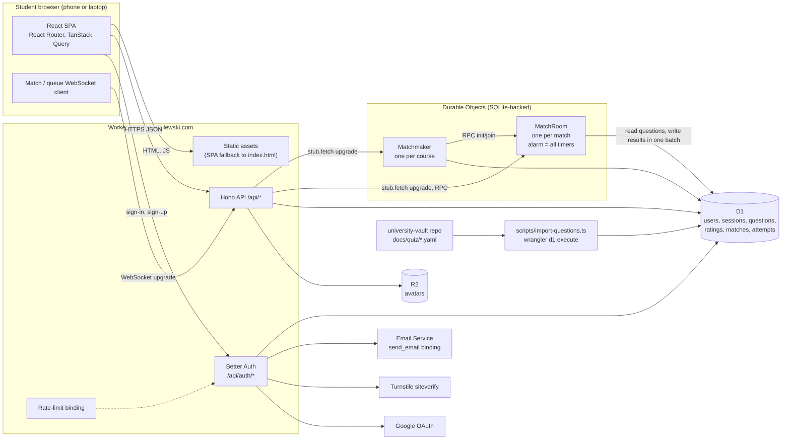

# Quiz app on Cloudflare: architecture

Researched 2026-10-22 against current Cloudflare, Better Auth, Drizzle and npm registry state. Sources are linked inline and collected at the end. Where a fact came from reading package source or probing the account API (read-only), that is said.

## Decisions at a glance

| Area | Pick | Why, briefly |
|---|---|---|
| Hosting | One Worker with static assets (SPA) via the Cloudflare Vite plugin | Workers has DOs, cron, rate limiting and logs that Pages lacks; Cloudflare calls the Vite plugin "the recommended way" to build Workers |
| CLI | wrangler 4.152 (stable). Do not adopt `cf` yet | `cf` launched 2026-09-28 as open beta (1.0.0-beta.20); it still delegates to wrangler for dev and deploy |
| Realtime | SQLite-backed Durable Objects: one `MatchRoom` per match, one `Matchmaker` per course, WebSocket Hibernation API, a single alarm per DO driving every timer | Server-authoritative, strongly consistent, already on the account's Workers Paid plan |
| Database | D1 (one database, Western Europe), Drizzle ORM 0.45 + drizzle-kit 0.31, SQL migrations applied by `wrangler d1 migrations apply` | Typed queries for agents; flat migrations folder that wrangler reads natively |
| Avatars | R2 bucket, served through the Worker; client-side crop and resize; no Cloudflare Images | Images adds cost and a low-fidelity local mode for no real gain at 150 users |
| Auth | Better Auth 1.7 on the Worker with the Drizzle adapter: email + password (native scrypt), Google, username plugin, Turnstile captcha plugin | Session handling, OAuth state/PKCE, reset and verification flows done and maintained; the old CPU problem is fixed (verified in source) |
| Email | Cloudflare Email Service (`send_email` binding), public beta | Account already has Workers Paid: 3,000 emails/month included; zone is on Cloudflare |
| Frontend | React 19 + Vite 8 + TypeScript, React Router 8 in data mode (client-side SPA), TanStack Query, Tailwind CSS 4, shadcn/ui | Agents are most reliable in this stack; no SSR needed for a logged-in game |
| Backend | Hono 4.13 on the Worker, zod 4 schemas shared with the client | Small, Workers-native, typed RPC client (`hc`) |
| Tests | `@cloudflare/vitest-plugin` (renamed from vitest-pool-workers) on Vitest 4.1.x; pure game engine unit tests; Playwright 1.56.1 two-context E2E | Matches preinstalled Chromium build; known DO WebSocket isolation caveat handled |
| Domain | Worker Custom Domain, e.g. `quiz.swasilewski.com` (hostname is currently free) | Cloudflare creates the DNS record and certificate itself |

## Component diagram



## Account facts checked (read-only API, 2026-10-22)

- Account `2b601c6ade78558b75079f4a71ac23c8` has **Workers Paid** ($5/month) and **R2 Paid** subscriptions active. So Durable Objects, 30 s default CPU per request, D1 at 10 GB per database, and Email Service arbitrary-recipient sending are all available without upgrading.
- Zone `swasilewski.com` (id `3be29b5ef448ff68d03697a583a416ce`) is active on the Free website plan. Existing hostnames: apex, www, bit, n8n, notes (vault site on Pages), bikeradar, dashboard, mcp. `quiz.swasilewski.com` is unused. No TXT or MX records exist on the zone, so Email Service onboarding will not collide with an existing DMARC record. Email Routing is unconfigured.
- Ten Workers, seven D1 databases and four R2 buckets already exist; none are named like this project.
- Two Turnstile widgets exist (the token can read widgets). The token can read Workers custom domains, routes and DO namespaces.
- **Wrangler auth through the proxy:** plain `npx wrangler whoami` reports "You are not authenticated". With `CLOUDFLARE_API_TOKEN=placeholder` and `CLOUDFLARE_ACCOUNT_ID=2b601c6ade78558b75079f4a71ac23c8` exported, `wrangler d1 list --json` works (the proxy replaces the header). Every wrangler command in this session needs those two variables set.
- Container: Node 22.22.0, Playwright 1.56.1 installed globally, Chromium build `chromium-1194` in `/opt/pw-browsers`, `PLAYWRIGHT_BROWSERS_PATH` and `PLAYWRIGHT_SKIP_BROWSER_DOWNLOAD=1` set.

## Hosting: Workers static assets

Cloudflare's direction is Workers: the Pages migration guide frames Workers as having "a distinctly broader set of features", and Cron Triggers, Workers Logs, Queue consumers and rate limiting are Workers-only. Durable Objects cannot be defined in a Pages project anyway, so Pages would need a second Worker. One Worker serving the SPA and the API is simpler.

Config essentials:

```jsonc
"assets": {
  "not_found_handling": "single-page-application",
  "run_worker_first": ["/api/*"]
}
```

`not_found_handling: "single-page-application"` returns `index.html` with 200 for unknown paths. `run_worker_first` with a pattern list makes `/api/*` (including the WebSocket upgrade routes and avatar serving) always hit the Worker, and everything else is served as a static asset without invoking it. Static asset limits on Paid: 100,000 files, 25 MiB each.

## Realtime: Durable Objects

### Plan and cost

- SQLite-backed DOs are on the Free plan too now ("Workers Free plan can only create and access SQLite-backed Durable Objects"), but this account is on Paid anyway.
- Paid includes 1M DO requests/month, 400,000 GB-s duration, 25 billion rows read, 50 million rows written, 5 GB-month storage. Incoming WebSocket messages bill at 20:1 (100 messages = 5 requests); outgoing messages are free. SQLite storage billing started January 2026.
- Rough load: a 10-round duel is about 40 incoming messages per player, so 4 billed requests per match. Duration: a non-hibernating DO is billed at 128 MB for wall time, so a 5-minute match is about 37.5 GB-s; 400,000 GB-s covers roughly 10,000 matches a month. Cost for 150 students is effectively zero above the existing $5.

### Limits that matter

- 32,768 WebSockets per DO (Hibernation API). 32 MiB per received message. Attachment per socket: 16,384 bytes serialized. Up to 10 tags per socket, 256 chars each.
- CPU 30 s per request or message by default. Alarm handler wall time limit 15 minutes.
- Storage per object 10 GB; key + value 2 MB on SQLite-backed objects.
- `blockConcurrencyWhile` has a 30 s timeout and resets the object if the callback throws.

### Hibernation behaviour

- `ctx.acceptWebSocket(server, tags)` instead of `server.accept()`. Events arrive in `webSocketMessage`, `webSocketClose`, `webSocketError` class methods.
- After about 10 s without events, the object can hibernate: in-memory state is gone, sockets stay connected, the constructor runs again on the next event. Anything needed after waking must be in storage or in the socket attachment.
- `setTimeout`/`setInterval` block hibernation. Use alarms for every timer.
- The docs are not fully consistent on alarms: the WebSockets page says "Events such as alarms, incoming requests, and scheduled callbacks prevent hibernation", while the lifecycle page does not list a scheduled alarm as blocking. Design so correctness never depends on whether the object hibernated: persist state after every mutation.
- Compatibility flags newer than most tutorials: with `compatibility_date >= 2026-04-07`, `web_socket_auto_reply_to_close` is on (runtime replies to Close frames; calling `ws.close()` inside `webSocketClose` is no longer needed but harmless). `websocket_close_reason_byte_limit` (2026-03-03) makes `close()` throw if the reason exceeds 123 UTF-8 bytes: keep close reasons short. `delete_all_deletes_alarm` (2026-02-24). `durable_object_io_tasks_prevent_eviction` (2026-10-01).
- `setWebSocketAutoResponse(new WebSocketRequestResponsePair("ping","pong"))` answers app-level heartbeats without waking the object.

### Alarms

- One alarm per DO. `setAlarm(ms)` overwrites the previous one. Keep a list of deadlines in state and always set the alarm to the earliest pending one.
- At-least-once delivery; on throw it retries with exponential backoff from 2 s, up to 6 retries. `alarm(alarmInfo)` gets `retryCount` and `isRetry`. The handler must be idempotent: check `now >= deadline` and the current phase before acting.
- Firing precision is not documented. Add a small grace (about 300 to 500 ms) after the advertised round deadline before the server stops accepting answers, and resolve early when both players have answered.

### Classes

**`MatchRoom`** (SQLite-backed, one per match, addressed by `env.MATCH_ROOM.getByName(matchId)`):

- State: one `MatchState` object stored with `ctx.storage.put("state", state)` after every change (well under the 2 MB value limit). It holds: match id, course, kind (lobby or ranked), phase, players (user id, display name, avatar, rating at start, HP, connected flag, disconnect deadline, surrendered flag), the selected questions **with answers**, the per-match option shuffle, round index, round deadline, per-round answers with server receive time, and the list of pending deadlines.
- Per-socket attachment: `{ userId, matchId }` only.
- Pure engine: all rules live in `src/shared/game/engine.ts` as a reducer `step(state, event, now) -> { state, outbox, deadlines }` with no Cloudflare imports. The DO is a thin shell: load state, call `step`, persist, send `outbox`, set alarm to `min(deadlines)`. This is what makes the game testable in plain Vitest and keeps agents from scattering rules across handlers.
- RPC methods called by the Worker: `init({ matchId, courseId, kind, hostUserId })`, `join(userId)`, `cancel(reason)`, `snapshotFor(userId)`.
- `fetch(request)` handles only the WebSocket upgrade. The Worker has already authenticated the user and passes `x-user-id`; the DO rejects users that are not players.
- On a second connection from the same user, the DO closes the older socket (code 4001, short reason) and keeps the new one.
- When the match ends: write results to D1 in one `batch` (see the data model), broadcast `match_end`, close sockets with code 1000, then `ctx.storage.deleteAll()` after a retention alarm (for example 10 minutes later) so reconnecting clients can still read the final result.

**`Matchmaker`** (SQLite-backed, one per course, `getByName("mm:" + courseId)`, created with `locationHint: "weur"`):

- Clients open `GET /api/queue/ws?course=<id>`. The attachment holds `{ userId, rating, joinedAt }`, so the queue survives hibernation without extra storage.
- On join, and on an alarm every 2 s while two or more sockets are queued: pair the two closest ratings whose difference is within a window that widens with wait time. Window size and growth are tunables, set in one config file and noted as a product decision.
- On a pair: generate a match id, insert the `matches` row in D1, call `MatchRoom.init` and `join` for both, send `{ type: "matched", matchId }` to both sockets, close them.
- A user already in an active match (D1 `matches.status = 'active'`) is refused with `already_in_match` plus the match id so the client can rejoin.

**Lobbies** need no extra class. `POST /api/lobbies` creates a match id and a 6-character join code (unambiguous alphabet, no 0/O/1/I), inserts the `matches` row with `status = 'lobby'`, calls `MatchRoom.init`. `POST /api/lobbies/join { code }` looks the code up in D1 (unique index), calls `MatchRoom.join`, returns the match id. Both players then connect to the same WebSocket route. A lobby expires through a `MatchRoom` alarm (for example 15 minutes), which sets the D1 row to `cancelled`.

### Match flow and timers

Phases: `lobby` -> `countdown` -> `round` -> `reveal` -> (`round` ...) -> `finished` (or `cancelled`).

| Deadline | Set when | On fire |
|---|---|---|
| lobby expiry | lobby created | cancel, notify, mark D1 row cancelled |
| ranked no-show | ranked match created | if a player never connected: cancel, no rating change |
| countdown end | both players connected and ready | start round 1 |
| round deadline (+ grace) | round starts | resolve with whoever answered |
| reveal end | round resolved | next round or finish |
| disconnect forfeit | a player's socket closes mid-match | if still disconnected: that player abandons, opponent wins |
| cleanup | match finished | `deleteAll()` |

The alarm is always set to the earliest live deadline. A disconnected player keeps getting rounds started; unanswered rounds score zero for them, as in GeoGuessr duels. If both players are disconnected past the forfeit deadline the match is voided with no rating change.

Scoring defaults to start from, all in one config file and flagged for Stas to confirm (none of these numbers is a decision anyone has made yet):

- Both players start with the same HP.
- Round score: a correct answer scores a base value scaled by question difficulty, multiplied by a speed factor that falls linearly from 1.0 at round start to 0.5 at the deadline. Wrong or no answer scores 0.
- Damage: the lower scorer takes `(higher score - lower score) * multiplier`, where the multiplier increases in later rounds so matches end.
- Match ends when a player's HP reaches 0, or after a maximum round count (higher HP wins, equal HP draws), or on surrender or abandon.
- Multiple select: exact set match counts as correct. Partial credit is a product question for Stas.

### Message protocol

All frames are JSON text with a `type` discriminator, validated with zod on both sides (schemas in `src/shared/protocol.ts`). Every server message carries `serverNow` (epoch ms) so the client can compute a clock offset and render countdowns from the server deadline.

Client to server:

| type | fields | notes |
|---|---|---|
| `ready` | | lobby: player is ready to start |
| `answer` | `round`, `answer` | `answer` is an option id, a list of ids, a boolean, or an ordered list; rejected after the deadline or if already answered |
| `surrender` | | ends match immediately |
| `ping` | | handled by `setWebSocketAutoResponse` without waking the DO |

Server to client:

| type | fields | notes |
|---|---|---|
| `snapshot` | full public state for this player | sent on every (re)connect; contains the current question without the answer, own submitted answer if any, whether the opponent has answered |
| `lobby` | players, ready flags, join code | lobby updates |
| `countdown` | `startsAt` | |
| `round_start` | `round`, `question` (prompt, type, options with per-match opaque ids), `deadline` | never contains correctness information |
| `opponent_answered` | `round` | no content of the answer |
| `round_result` | `round`, `correct` answer, both answers, scores, damage, HP | first time the answer leaves the server |
| `opponent_connection` | `connected`, `forfeitAt` | drives the "opponent disconnected" banner |
| `match_end` | `winnerId`, `reason` (`hp`, `rounds`, `surrender`, `abandon`, `void`), rating deltas, final HP | |
| `error` | `code`, `message` | e.g. `not_a_player`, `round_closed`, `already_answered` |

Close codes: 1000 normal end, 4001 replaced by a newer connection, 4003 not authorised, 4004 match not found.

Answer secrecy: `questions.answer_json` is loaded only inside `MatchRoom` and the singleplayer answer endpoint. Option ids are random per match, so a client cannot map an option to a stored answer key. The one leak outside the app: if the question bank is published anywhere public (the vault site), a student can look answers up. Keep the bank in a part of the vault that the site does not publish (see the import pipeline).

### Reconnect

- Client: on close with any code other than 1000/4001/4003/4004, reconnect with exponential backoff (0.5 s doubling to 5 s, with jitter) to the same URL. On `visibilitychange` to visible, reconnect immediately if closed (phones suspend sockets when the screen locks).
- Server: on connect, clear the player's disconnect deadline, send `snapshot`, tell the opponent `opponent_connection: connected`.
- The client can always find its active match: `GET /api/me/active-match` reads D1 and returns the match id, so a refreshed tab or a different device rejoins.

## Singleplayer

Untimed and server-authoritative over plain HTTP, no DO needed:

- `POST /api/practice/sessions { courseId }` creates a session.
- `GET /api/practice/sessions/:id/next` picks a question near the player's singleplayer rating that they have not seen recently, returns it without the answer, records it as served.
- `POST /api/practice/sessions/:id/answer { questionId, answer }` checks the answer, returns correctness, the correct answer and the explanation, and in one D1 `batch` inserts the attempt and applies the rating updates.

Ratings: Elo-style, player against question (the approach chess puzzle sites use). Expected score `E = 1 / (1 + 10^((Rq - Rp)/400))`; player `Rp += K * (S - E)`; question `Rq -= Kq * (S - E)`. Updates use relative SQL (`rating = rating + ?`) so concurrent answers on the same question do not overwrite each other. Points per question come from the question's current rating band. Initial question rating comes from the authored difficulty. K values and band edges are tunables for Stas to confirm.

Multiplayer rating: the same Elo formula between the two players, applied once at match end, written as relative deltas.

## Database: D1

Limits on Workers Paid: 10 GB per database, 1,000 queries per Worker invocation, 100 bound parameters per query, 100 KB per statement, 2 MB per row, 30 s per query, 30-day Time Travel. Pricing included: 25 billion rows read and 50 million rows written per month. No interactive transactions: use `db.batch([...])`, which runs as one transaction and rolls back entirely if any statement fails.

Create with `--location weur` so the primary sits near Amsterdam.

### Tables

Better Auth core tables (names and columns from `@better-auth/core` 1.7.12 source). Defined in the Drizzle schema so one migration tool owns everything.

**user**: `id` text PK, `name` text (set to first name + surname), `email` text unique, `emailVerified` integer bool, `image` text (avatar URL), `createdAt`, `updatedAt`, plus username plugin `username` text unique (lowercased), `displayUsername` text, plus additional fields `firstName` text, `lastName` text, `role` text default `'user'` (`input: false`).

**session**: `id`, `token` unique, `userId` FK, `expiresAt`, `ipAddress`, `userAgent`, `createdAt`, `updatedAt`.

**account**: `id`, `accountId`, `providerId` (`credential` or `google`), `userId` FK, `accessToken`, `refreshToken`, `idToken`, `accessTokenExpiresAt`, `refreshTokenExpiresAt`, `scope`, `password` (scrypt hash for credential accounts), `createdAt`, `updatedAt`.

**verification**: `id`, `identifier`, `value`, `expiresAt`, `createdAt`, `updatedAt`.

**rateLimit** (only if Better Auth rate limit storage is set to database): `id`, `key`, `count`, `lastRequest`.

App tables (snake_case, integer epoch ms timestamps):

**courses**: `id` text PK (course code, lowercase), `title`, `active` integer, `sort` integer.

**questions**: `id` text PK (stable id from the vault, e.g. `mnlp-l02-007`), `course_id` FK, `lecture` text, `topic` text, `type` text (`single`, `multi`, `truefalse`, `ordering`, `matching`), `prompt_md` text, `options_json` text (array of `{ key, text_md }`; ordering and matching store their items here), `answer_json` text (server only), `explanation_md` text, `authored_difficulty` integer, `rating` real, `rating_n` integer, `attempts` integer, `correct` integer, `status` text (`active`, `retired`), `content_hash` text, `source_path` text, `created_at`, `updated_at`. Index on `(course_id, status, rating)`.

**ratings**: `user_id` FK, `course_id` FK, `mode` text (`sp`, `mp`), `rating` real, `played`, `won`, `lost`, `drawn`, `abandoned`, `answered`, `correct`, `points` (all integer), `updated_at`. PK `(user_id, course_id, mode)`. Index on `(course_id, mode, rating DESC)` for leaderboards.

**sp_sessions**: `id` text PK, `user_id`, `course_id`, `started_at`, `ended_at`, `answered`, `correct`, `points`, `rating_start`, `rating_end`.

**sp_attempts**: `id` text PK, `session_id`, `user_id`, `question_id`, `served_at`, `answered_at`, `answer_json`, `correct` integer, `points`, `player_delta` real, `question_delta` real. Index on `(user_id, answered_at)` and `(user_id, question_id)`.

**matches**: `id` text PK, `course_id`, `kind` (`lobby`, `ranked`), `join_code` text unique nullable, `status` (`lobby`, `active`, `finished`, `cancelled`), `player_a`, `player_b` nullable, `winner_id` nullable, `end_reason`, `rounds_played`, `hp_a`, `hp_b`, `rating_a_before`, `rating_a_after`, `rating_b_before`, `rating_b_after`, `created_at`, `started_at`, `ended_at`. Indexes on `(player_a, ended_at)`, `(player_b, ended_at)`, `(status)`.

**match_rounds**: `match_id`, `round_no`, `question_id`, `answer_a_json`, `answer_b_json`, `correct_a`, `correct_b`, `ms_a`, `ms_b`, `score_a`, `score_b`, `damage_a`, `damage_b`, `hp_a_after`, `hp_b_after`. PK `(match_id, round_no)`. Written in the end-of-match batch.

**match_finalizations**: `match_id` text PK, `finalized_at`. First statement of the end-of-match batch. Because the batch is all-or-nothing, an alarm retry that runs the batch again fails on this primary key and nothing is applied twice; the DO treats that constraint error as "already done".

**question_imports**: `id`, `vault_commit`, `course_id`, `added`, `updated`, `retired`, `imported_at`. Audit trail for the importer.

Avatars live in R2; the user row only stores the URL.

### Drizzle and migrations

- Use `drizzle-orm@0.45.x` and `drizzle-kit@0.31.x` (current `latest` tags). drizzle-kit 0.31 writes flat `migrations/0000_x.sql` files, which `wrangler d1 migrations apply` reads by default; its `meta/` subfolder is ignored.
- Drizzle's own D1 page now tells people to install the `rc` (1.0.0-rc.5). Drizzle 1.0 writes one folder per migration (`migrations/<name>/migration.sql`), which wrangler only finds with `"migrations_pattern": "migrations/*/migration.sql"`. Do not mix the two; if anyone upgrades, set `migrations_pattern` in the same change.
- Better Auth's schema generator is now the `auth` npm package (`npx auth@latest generate`). It imports the auth config in Node, where `cloudflare:workers` does not exist. Keep the Better Auth options in a factory `createAuth(db, env)` with no module-level Cloudflare imports, plus a small `auth.cli.ts` that builds it with a dummy Drizzle instance for the generator. Generate once into `src/worker/db/auth-schema.ts`, then commit and edit by hand when plugins change.
- Local: `wrangler d1 migrations apply DB --local`; production: `--remote`. Always pass the flag explicitly.

## Avatars

- Client: file picker, square crop UI, resize to 256x256 on a canvas, encode as JPEG at quality around 0.85 (iOS Safari's `canvas.toBlob` WebP encoding has historically been unreliable, JPEG is safe everywhere). Typical result 15 to 40 KB.
- Upload: `PUT /api/me/avatar` with the raw bytes. The Worker enforces a byte limit (for example 512 KB), checks magic bytes for JPEG/PNG/WebP, writes to R2 at `avatars/<userId>/<random>.jpg`, updates `user.image` to `/api/avatars/<key>`, deletes the previous object.
- Serve: `GET /api/avatars/*` streams from R2 with `Cache-Control: public, max-age=31536000, immutable` (the key changes on every upload), `X-Content-Type-Options: nosniff`, and the stored content type from an allowlist.
- Google users start with Google's `picture` URL in `image` until they upload their own.
- R2 free allowance alone (10 GB-month, 1M writes, 10M reads, free egress) covers this many times over.
- Cloudflare Images binding: 5,000 unique transformations/month free, then $0.50 per 1,000; input up to 20 MB; local `wrangler dev` supports only width, height, rotate and format. Not worth it when the client already sends a 256 px image. Revisit only if server-side re-encoding to strip metadata becomes a requirement.

## Auth

### Options compared

**Better Auth 1.7.12 + Drizzle adapter on D1 (picked).**
- Native D1 support since 1.5 (`database: env.DB`, Kysely, uses `batch()` for atomicity). The Drizzle adapter also works on D1: in 1.7.12 its transaction paths are MySQL-only and `transaction` defaults to false (checked in `@better-auth/drizzle-adapter` source). Using Drizzle keeps one schema and one migration tool for auth and app tables.
- Password hashing: in early 2026 better-auth's pure-JS scrypt from `@noble/hashes` blew through Workers CPU limits (issue #8860, better-auth 1.4.18). Fixed by PR #8685. In the current release, `@better-auth/utils@0.5.0` has a `workerd` export condition that resolves to `password.node.mjs`, which uses native `node:crypto.scrypt` with N=16384, r=16, p=1, 64-byte key (read from the published package). workerd caps scrypt cost at N*r*p <= 2^20; this is 2^18, inside the cap. It needs `nodejs_compat`. Native scrypt at these parameters costs tens of milliseconds of CPU, fine on Paid (30 s default), impossible on Free (10 ms).
- Google: `socialProviders.google` with `prompt: "select_account"`; `mapProfileToUser` copies `given_name` and `family_name` into `firstName` and `lastName`. Callback path `/api/auth/callback/google`. `baseURL` must be set or Google returns `redirect_uri_mismatch`.
- Username: `username()` plugin adds `username` (lowercased, unique) and `displayUsername`; default 3 to 30 chars of letters, digits, underscore, dot; `signIn.username` endpoint; `isUsernameAvailable` endpoint. Google sign-ups have no username: the app sends any user with `username IS NULL` to an onboarding screen before anything else.
- Turnstile: `captcha({ provider: "cloudflare-turnstile", secretKey })` protects sign-up, sign-in and password-reset by default; the client sends the token in the `x-captcha-response` header.
- Mount in Hono before any catch-all: `app.on(["GET","POST"], "/api/auth/*", c => createAuth(...).handler(c.req.raw))`. Requires `nodejs_compat` (AsyncLocalStorage); that flag is default-on for compatibility dates from 2026-08-04, but set it explicitly.
- Rate limiting: Better Auth's default limiter stores counters in memory, which is per isolate on Workers. Either set its storage to `"database"` (adds the `rateLimit` table) or use the Workers rate-limit binding in front of `/api/auth/*`. Picked: the binding, keyed by IP for auth routes only (the docs advise against IP keys generally; here there is no user id yet), plus Turnstile.

**Hand-rolled (PBKDF2 via WebCrypto, session cookies, arctic 3.7 for Google).**
- workerd hard-caps PBKDF2 at **100,000 iterations** (`DEFAULT_MAX_PBKDF2_ITERATIONS` in `src/workerd/io/limit-enforcer.h`; the comment admits this is "WAY below the recommended minimum"). OWASP asks for 600,000 for PBKDF2-HMAC-SHA256. Some 2026 tutorials show 600,000 in Workers; per the source that call throws "iteration counts above 100000 are not supported". Hand-rolling would mean native `node:crypto.scrypt` anyway.
- Also means writing sessions, CSRF handling, OAuth state and PKCE, reset tokens, verification tokens, and their tests. More code for agents to get subtly wrong, with no benefit at this scale.

**Other.** Cloudflare Access cannot do public sign-up. Auth.js has a D1 adapter but is weaker on email + password. Hosted providers (Clerk and similar) add an external dependency and cost for no gain here.

### Email sending

- **Cloudflare Email Service** (public beta since 2026-04-16): `send_email` binding, `env.EMAIL.send({ to, from, subject, text, html })`. Requires Workers Paid for arbitrary recipients (account has it). 3,000 emails/month included, then $0.35 per 1,000. 50 recipients per message, 5 MiB per message. New accounts start with "a conservative daily quota" that grows; the number is not published. Sender domain must be onboarded: dashboard, Compute > Email Service > Email Sending > Onboard Domain; it adds MX/SPF/DKIM on `cf-bounce.<domain>` and a DMARC record on `_dmarc.<domain>`. In `wrangler dev` / `vite dev` the binding is simulated (email logged and saved locally) unless the binding has `remote: true`. Restrict the binding with `allowed_sender_addresses: ["noreply@swasilewski.com"]`.
- **Resend** is the fallback if Email Service misbehaves in beta: HTTP API, free tier around 3,000 emails/month with a daily cap (check current numbers before switching).
- Email Routing's `send_email` binding without onboarding can only send to verified destination addresses in the account, so it cannot do password resets for students.

### Is email verification needed?

For 20 to 150 students, Google sign-in already gives verified addresses, and the password reset flow needs a working sender regardless. Recommended start: send a verification email on sign-up but do not block sign-in (`requireEmailVerification: false`); show a banner until verified. This keeps a beta email service out of the critical sign-up path while still letting password reset work. If fake accounts on the leaderboard become a problem, flipping to required verification is one config change. This is a decision for Stas; the doc does not assume it.

## Frontend

- React 19.2+ (19.3.1 current), Vite 8, TypeScript, `@cloudflare/vite-plugin` 1.64 (peer: vite 6 to 8, wrangler >= 4.151).
- Routing: React Router 8 in data mode (`createBrowserRouter`) as a client-only SPA. v8 (released 2026-06-17) is ESM-only, needs Node >= 22.22.0 and React >= 19.2.7, and turns middleware on by default. The container's Node is exactly 22.22.0. Framework mode (SSR on Workers) is officially supported by the Vite plugin but adds loaders, server rendering and hydration for no benefit on a logged-in game.
- Data: TanStack Query 5 over Hono's typed `hc` client. Realtime: one small WebSocket hook per match with reconnect, zod-parsed messages, and a reducer for match UI state.
- UI: Tailwind CSS 4.3 (`@tailwindcss/vite`) and shadcn/ui components copied into the repo. Mobile-first: large tap targets for answer buttons, bottom-anchored answer area, `100dvh` layouts, no hover-only affordances, haptics via `navigator.vibrate` where available, wake lock during a match (`navigator.wakeLock`) so the screen does not sleep mid-duel.
- Auth client: `better-auth/react` `createAuthClient` with `usernameClient()`.
- Alternatives rejected: SvelteKit (fine, but agents produce more reliable React), Hono JSX (no client interactivity model), TanStack Start (newer, less agent familiarity).

## Backend

- Hono 4.13 on the Worker. Routes under `/api`: `auth/*` (Better Auth), `me`, `me/avatar`, `me/active-match`, `users/:username`, `courses`, `practice/*`, `lobbies`, `lobbies/join`, `matches/:id`, `matches/:id/ws`, `queue/ws`, `leaderboards/:course?mode=sp|mp`, `history`, `avatars/*`.
- Validation: zod 4.6 with `@hono/zod-validator` 0.9. One `src/shared` folder holds zod schemas for HTTP bodies and WebSocket messages, imported by both sides.
- Auth middleware: `auth.api.getSession({ headers })` once per request, put the user on the Hono context. For WebSocket routes, also check `Origin` equals the app origin (cookies are sent on cross-site WebSocket handshakes).
- WebSocket routes: authenticate, check membership, then `return stub.fetch(new Request(c.req.raw, { headers: withUserId }))`. Do not use Hono's `upgradeWebSocket` helper; the DO owns the socket.
- D1 access through Drizzle (`drizzle(env.DB)`), with `db.batch([...])` for multi-statement writes. Leaderboards are direct indexed queries; at this scale no caching layer is needed.

## Question import pipeline

### Source format in the vault

The vault's flashcards are free-form. Only MNLP has closed-form material today: about 90 `True or false:` cards and 36 `Multiple selection:` cards across its seven lecture notes, in a consistent format (`(A) ... (B) ...` options and `**A and C.**` answers). PhilSci has one. IR, RL and RecSys have none. Which two courses the app launches with is not settled in anything I read.

Recommended: a dedicated question bank in the vault at `docs/quiz/<COURSE>/<lecture-slug>.yaml`.

- `docs/` is hidden from Obsidian and unpublished by the vault site (the vault rules keep the flashcard archive "unpublished, in docs/"), so answers do not end up on `notes.swasilewski.com`. Verify against the site's `sync.sh` before relying on it.
- YAML is easier for an importer and for authoring agents to get exactly right than Markdown callouts.
- One-off bootstrap: a converter that turns MNLP's existing T/F and multiple-selection cards into YAML, with ids assigned once.

Example:

```yaml
course: MNLP
lecture: MNLP-L02
questions:
  - id: mnlp-l02-001          # stable forever; never reuse
    type: truefalse
    difficulty: 1             # 1 to 3, seeds the initial rating
    prompt: "NFKD normalization is lossless."
    answer: false
    explanation: "Compatibility forms are lossy: the long s becomes s."
  - id: mnlp-l02-014
    type: multi
    difficulty: 2
    prompt: "Which languages break the assumption that words are separated by whitespace?"
    options: { A: Thai, B: Russian, C: Khmer, D: German }
    answer: [A, C]
    explanation: "Russian breaks word order; German breaks one word, one meaning."
```

Types: `single` (`answer: B`), `multi` (`answer: [A, C]`), `truefalse` (`answer: true`), `ordering` (`items` list in correct order; shown shuffled), `matching` (`left` and `right` keyed lists, `answer` as pairs).

### Importer

`scripts/import-questions.ts`, run with Node (`tsx`):

1. Read `--vault <path>` and `--course <code>`, parse every YAML file, validate each question with the shared zod schema (unique ids, answer keys exist in options, types consistent). Fail loudly with file and id on any error.
2. Compute a `content_hash` per question over prompt, options, answer.
3. Write a SQL file of `INSERT ... ON CONFLICT(id) DO UPDATE SET prompt_md=excluded.prompt_md, ...` that never touches `rating`, `rating_n`, `attempts`, `correct`. Questions present in D1 but missing from the vault get `status = 'retired'` (never deleted; match history references them). Add a `question_imports` row with the vault's git commit.
4. Apply with `wrangler d1 execute DB --remote --file <generated.sql>` (or `--local` for dev). Statements stay well under the 100 KB statement limit.
5. Print a plain summary: added, changed, retired, unchanged.

If a question's answer changes materially, its rating is now measuring a different question. The importer reports these separately; whether to reset their rating is a decision for Stas.

## Repo layout

One deployable package. The Cloudflare React template is a single package with the client and Worker side by side, and a multi-package workspace adds build wiring that agents tend to break. Shared code is a folder with a path alias.

```
<app-repo>/
  package.json
  wrangler.jsonc
  vite.config.ts                # react(), tailwindcss(), cloudflare()
  vitest.config.ts              # worker + DO + D1 tests (cloudflareTest plugin)
  vitest.unit.config.ts         # pure engine and importer tests, plain Node
  playwright.config.ts
  drizzle.config.ts
  tsconfig.json                 # references app, worker, node configs
  index.html
  migrations/                   # drizzle-kit output, applied by wrangler
  public/                       # icons, manifest
  src/
    client/
      main.tsx
      router.tsx
      routes/                   # home, login, signup, onboarding, profile, practice,
                                # lobby, queue, match, leaderboard, history, user
      components/ui/            # shadcn/ui
      components/
      lib/api.ts                # hc client
      lib/auth-client.ts
      lib/match-socket.ts       # reconnecting WebSocket hook
    shared/
      protocol.ts               # zod: WebSocket messages
      api-schemas.ts            # zod: HTTP bodies
      question-schema.ts        # zod: question bank format, used by importer and worker
      game/engine.ts            # pure match reducer
      game/rating.ts            # Elo
      game/config.ts            # all tunables in one place
    worker/
      index.ts                  # Hono app, exports MatchRoom and Matchmaker
      auth.ts                   # createAuth(db, env)
      auth.cli.ts               # for npx auth generate only
      routes/                   # me, practice, lobbies, matches, queue, leaderboards, avatars
      do/match-room.ts
      do/matchmaker.ts
      db/schema.ts              # app tables
      db/auth-schema.ts         # Better Auth tables
      email.ts                  # Email Service wrapper
  scripts/
    import-questions.ts
    bootstrap-mnlp-cards.ts     # one-off card to YAML converter
  test/
    worker/                     # vitest-plugin tests
    unit/
    e2e/
```

## Configuration sketch

```jsonc
{
  "$schema": "node_modules/wrangler/config-schema.json",
  "name": "<worker-name>",
  "main": "src/worker/index.ts",
  "compatibility_date": "2026-10-15",
  "compatibility_flags": ["nodejs_compat"],
  "workers_dev": false,
  "preview_urls": false,
  "routes": [{ "pattern": "quiz.swasilewski.com", "custom_domain": true }],
  "observability": { "enabled": true },
  "assets": {
    "not_found_handling": "single-page-application",
    "run_worker_first": ["/api/*"]
  },
  "d1_databases": [
    { "binding": "DB", "database_name": "<db-name>", "database_id": "<from d1 create>", "migrations_dir": "migrations" }
  ],
  "r2_buckets": [{ "binding": "AVATARS", "bucket_name": "<bucket-name>" }],
  "durable_objects": {
    "bindings": [
      { "name": "MATCH_ROOM", "class_name": "MatchRoom" },
      { "name": "MATCHMAKER", "class_name": "Matchmaker" }
    ]
  },
  "migrations": [{ "tag": "v1", "new_sqlite_classes": ["MatchRoom", "Matchmaker"] }],
  "send_email": [{ "name": "EMAIL", "allowed_sender_addresses": ["noreply@swasilewski.com"] }],
  "ratelimits": [{ "name": "AUTH_LIMITER", "namespace_id": "<unique int>", "simple": { "limit": 20, "period": 60 } }],
  "vars": { "APP_URL": "https://quiz.swasilewski.com", "TURNSTILE_SITE_KEY": "<site key>" }
}
```

Secrets (never in the file): `BETTER_AUTH_SECRET`, `GOOGLE_CLIENT_ID`, `GOOGLE_CLIENT_SECRET`, `TURNSTILE_SECRET_KEY`. Local values in `.dev.vars` (gitignored), with Turnstile test keys: site key `1x00000000000000000000AA` and secret `1x0000000000000000000000000000000AA` (always pass, work on localhost).

`workers_dev: false` follows the pattern already used for `life-ops-dashboard`. The DO class list in `migrations` is append-only: renaming or deleting a class later needs a `renamed_classes` / `deleted_classes` migration, and a KV-backed class can never become SQLite-backed, so `new_sqlite_classes` must be right on the first deploy.

## Testing

**Unit (plain Vitest, Node):** the match engine reducer, Elo, scoring, the question schema and importer. Most game logic bugs get caught here, fast, without workerd. Use fake `now` values passed in; the engine never reads the clock itself.

**Worker, DO and D1 (`@cloudflare/vitest-plugin` 1.4.7):**
- The package was renamed from `@cloudflare/vitest-pool-workers` on 2026-08-19. Most tutorials and agent memory use the old name and the old `defineWorkersConfig` API. Current setup: `import { cloudflareTest } from "@cloudflare/vitest-plugin"` as a Vite plugin inside `defineConfig` from `vitest/config`, with `wrangler: { configPath: "./wrangler.jsonc" }`.
- Pin Vitest to `4.1.x`. Vitest 5.0.5 is `latest` and the new plugin's peer range allows `^5`, but the old 0.x package requires `^4.1.0`, and 4.1 is the line the Cloudflare docs were written against.
- APIs: `env` and `exports` from `cloudflare:workers` (`exports` replaces `SELF`); `runInDurableObject`, `runDurableObjectAlarm`, `listDurableObjectIds`, `applyD1Migrations` from `cloudflare:test`. Migrations: `readD1Migrations("migrations")` in the config, exposed as a `TEST_MIGRATIONS` binding, applied in a setup file.
- Known issue: WebSockets to Durable Objects do not work with per-file storage isolation. Run the DO WebSocket test files in a separate Vitest project with `--max-workers=1 --no-isolate`.
- Testing a duel inside workerd: open two WebSocket upgrades via `exports.default.fetch` with a test-only session for two seeded users, send answers, then `runDurableObjectAlarm(stub)` to fire the round deadline without waiting. Assert that no `round_start` frame contains an answer key (a test that scans every server frame before `round_result` for the answer value).
- Dispose DO stubs and RPC results with `using`.

**End to end (Playwright 1.56.1):**
- Pin `@playwright/test@1.56.1` so it matches the preinstalled `chromium-1194` in `/opt/pw-browsers`. A newer Playwright looks for a newer Chromium build and fails because downloads are disabled.
- `webServer`: `vite build` then `vite preview` (runs the built Worker in workerd, same as production), after `wrangler d1 migrations apply DB --local` and a seed step.
- A test mode, enabled only by a `.dev.vars` value that does not exist in production config, exposes `POST /api/test/seed` (fixed question set, test users) and shortens timers. The worker refuses these routes unless the flag is present and the request comes from localhost.
- Two-player test: one test, `browser.newContext()` twice (separate cookie jars), each signs in as a different user. Player A creates a lobby and reads the code from the page; player B joins with it. Drive both pages with `Promise.all` where actions are simultaneous. Cover: full match to HP zero; one player times out a round; surrender; reconnect (`pageB.close()` then a new page in the same context navigates back and sees the snapshot); abandon (close context B, wait past a shortened forfeit deadline, A sees the win); ranked queue pairing of two contexts.
- Use the Turnstile always-pass test keys in E2E. Google OAuth is not E2E-tested; unit-test `mapProfileToUser` and the onboarding redirect instead.
- Mobile: run the suite under a phone viewport project (`devices["Pixel 7"]`, Chromium) as well as desktop.

## Deploy steps (from this container)

Run these during the build phase.

```bash
export CLOUDFLARE_API_TOKEN=placeholder          # proxy injects the real token
export CLOUDFLARE_ACCOUNT_ID=2b601c6ade78558b75079f4a71ac23c8

npx wrangler d1 create <db-name> --location weur  # copy database_id into wrangler.jsonc
npx wrangler r2 bucket create <bucket-name>
npx wrangler d1 migrations apply DB --remote

# secrets: values via stdin so they never hit shell history or files
openssl rand -base64 32 | npx wrangler secret put BETTER_AUTH_SECRET
printf %s "$GOOGLE_CLIENT_ID"     | npx wrangler secret put GOOGLE_CLIENT_ID
printf %s "$GOOGLE_CLIENT_SECRET" | npx wrangler secret put GOOGLE_CLIENT_SECRET
printf %s "$TURNSTILE_SECRET"     | npx wrangler secret put TURNSTILE_SECRET_KEY

npm run build            # vite build: writes dist/ with a generated wrangler.json
npx wrangler deploy      # picks up the generated config via .wrangler/deploy/config.json

npx tsx scripts/import-questions.ts --vault ../university-vault --course MNLP --remote
```

- Wrangler can auto-provision D1 and R2 when ids are omitted (since 4.45) and writes the ids back into the config on a local deploy. Explicit creation is clearer for the audit trail and lets you pass `--location weur`.
- `wrangler secret put` against a Worker that does not exist yet creates it; deploy once first to keep things in order.
- Custom domain: the `routes` entry with `custom_domain: true` makes `wrangler deploy` create the DNS record and certificate. It fails if a CNAME already exists on that hostname (none does for `quiz`).
- The zone's SSL mode is Flexible. That does not affect a Worker custom domain (the Worker is the origin), but it is worth knowing if anything else is proxied there.
- Turnstile widget: create in the dashboard (or via `POST /accounts/{id}/challenges/widgets`, which the token can at least read) with hostnames `quiz.swasilewski.com` and, for manual local testing with a real key, `localhost`.
- Email Service domain onboarding: dashboard, or the zone-level `email/sending/subdomains` API that the token can read; not yet tried for writes.

## What Stas has to do by hand

1. **Google OAuth client** (cannot be done from here):
   1. Open https://console.cloud.google.com, create a project (for example "Quiz").
   2. Go to Google Auth Platform > Branding: app name, user support email, developer contact email, and add `swasilewski.com` under Authorized domains.
   3. Audience: User type External. Then select **Publish app** to move it to In production. In Testing, only up to 100 listed test users can sign in and their consent expires after 7 days. With only `openid`, `email` and `profile` scopes, Google's verification process is tied to sensitive scopes, so publishing should not need a review; Google may still show a brand verification step for the logo, which can be skipped by not uploading a logo.
   4. Data access: add scopes `openid`, `.../auth/userinfo.email`, `.../auth/userinfo.profile`.
   5. Clients > Create client > Web application. Authorized JavaScript origins: `https://quiz.swasilewski.com`, `http://localhost:5173`. Authorized redirect URIs: `https://quiz.swasilewski.com/api/auth/callback/google`, `http://localhost:5173/api/auth/callback/google`.
   6. Copy the client ID and client secret immediately: Google now shows the secret only on the creation screen. If lost, rotate it under the client.
   7. Hand both to the session (or run the two `wrangler secret put` commands himself).
2. **Email Service sending domain**: Cloudflare dashboard > Compute > Email Service > Email Sending > Onboard Domain > `swasilewski.com` > Done. Check status under Email Sending > Settings after 5 to 15 minutes. (An agent can try this through the API if he prefers.)
3. **Product decisions** the build needs, each with a sensible default already in `game/config.ts`: the subdomain name; which two courses; HP, damage multiplier and round cap; round timer length; partial credit for multiple select; Elo K values and starting ratings; whether email verification blocks sign-in; whether a changed question resets its rating.
4. **Question bank**: confirm the bank can live in `docs/quiz/` of the vault and that the site does not publish `docs/`.

## Risks and version pitfalls

- **Package rename:** `@cloudflare/vitest-pool-workers` is now `@cloudflare/vitest-plugin` (1.x). Old API names (`defineWorkersConfig`, `SELF`) are what agents will reach for by default.
- **Vitest major:** Vitest 5 is `latest`; stay on 4.1.x unless the plugin docs say otherwise.
- **Playwright pin:** must be 1.56.1 in this container.
- **Drizzle 1.0 rc** changes the migrations folder layout; wrangler needs `migrations_pattern` for it. Stay on 0.45/0.31 or switch both at once.
- **PBKDF2 cap of 100,000 iterations** in workerd; tutorials showing 600,000 will throw at runtime.
- **Better Auth CLI** cannot import a config that imports `cloudflare:workers`; use the factory pattern.
- **Better Auth default rate limiter** is in-memory per isolate on Workers; it does not limit anything globally.
- **React Router 8** needs Node >= 22.22.0, which the container has exactly. Any CI or machine on older Node 22 fails.
- **`cf` CLI** is beta; Cloudflare's Vite plugin docs already mention `cf build` and `cf deploy`. Stay on wrangler 4 until `cf` leaves beta; wrangler gets 18 months of maintenance after that.
- **Email Service** is beta with an unpublished, conservative starting daily quota. A burst of sign-ups in a lecture hall could hit it; keep verification non-blocking and log send failures.
- **Hibernation and alarms** are documented inconsistently; persist state after every change so it does not matter.
- **WebSocket close reasons over 123 bytes throw** with current compatibility dates.
- **Phones suspend WebSockets** when the screen locks or the app is backgrounded; the forfeit grace period has to tolerate a student checking a notification.
- **One alarm per DO**: every timer must go through the deadline list or one silently overwrites another.
- **Alarm retries**: at-least-once, so the end-of-match D1 write must be idempotent (the `match_finalizations` primary key does this).
- **DO class migrations are permanent**: `new_sqlite_classes` on the first deploy, never edit an applied migration tag.
- **Answer leakage outside the app**: if the YAML bank is ever published or the vault repo is public, answers are one search away.
- **D1 has no interactive transactions**: read-then-write logic that must be atomic needs a `batch` with relative updates or a constraint to guard it.

## Sources

- Durable Objects pricing: https://developers.cloudflare.com/durable-objects/platform/pricing/
- Durable Objects limits: https://developers.cloudflare.com/durable-objects/platform/limits/
- WebSocket Hibernation: https://developers.cloudflare.com/durable-objects/best-practices/websockets/
- DurableObjectState API (tags, auto-response, 32,768 sockets): https://developers.cloudflare.com/durable-objects/api/state/
- Alarms API: https://developers.cloudflare.com/durable-objects/api/alarms/
- DO lifecycle and hibernation: https://developers.cloudflare.com/durable-objects/concepts/durable-object-lifecycle/
- DO location hints: https://developers.cloudflare.com/durable-objects/reference/data-location/
- Compatibility flags: https://developers.cloudflare.com/workers/configuration/compatibility-flags/
- Workers limits: https://developers.cloudflare.com/workers/platform/limits/
- Static assets: https://developers.cloudflare.com/workers/static-assets/
- Migrating from Pages: https://developers.cloudflare.com/workers/static-assets/migration-guides/migrate-from-pages/
- Vite plugin: https://developers.cloudflare.com/workers/vite-plugin/
- React on Workers: https://developers.cloudflare.com/workers/framework-guides/web-apps/react/
- `cf` CLI launch: https://blog.cloudflare.com/cloudflare-cf-cli-launch
- Custom Domains: https://developers.cloudflare.com/workers/configuration/routing/custom-domains/
- D1 limits: https://developers.cloudflare.com/d1/platform/limits/
- D1 pricing: https://developers.cloudflare.com/d1/platform/pricing/
- D1 migrations (incl. `migrations_pattern`): https://developers.cloudflare.com/d1/reference/migrations/
- Automatic resource provisioning: https://developers.cloudflare.com/changelog/2025-10-24-automatic-resource-provisioning/
- R2 pricing: https://developers.cloudflare.com/r2/pricing/
- Images pricing: https://developers.cloudflare.com/images/pricing/
- Images binding: https://developers.cloudflare.com/images/transform-images/bindings/
- Rate limiting binding: https://developers.cloudflare.com/workers/runtime-apis/bindings/rate-limit/
- Turnstile testing keys: https://developers.cloudflare.com/turnstile/troubleshooting/testing/
- Node crypto in Workers: https://developers.cloudflare.com/workers/runtime-apis/nodejs/crypto/
- workerd PBKDF2 and scrypt caps: https://github.com/cloudflare/workerd/blob/main/src/workerd/io/limit-enforcer.h
- Email Service overview: https://developers.cloudflare.com/email-service/
- Email Service pricing: https://developers.cloudflare.com/email-service/platform/pricing/
- Email Service limits: https://developers.cloudflare.com/email-service/platform/limits/
- Email Service send bindings: https://developers.cloudflare.com/email-service/configuration/send-bindings/
- Email Service domains: https://developers.cloudflare.com/email-service/configuration/domains/
- Email Service local dev: https://developers.cloudflare.com/email-service/local-development/sending/
- Email Service public beta post: https://blog.cloudflare.com/email-for-agents
- Vitest integration: https://developers.cloudflare.com/workers/testing/vitest-integration/
- Vitest plugin configuration: https://developers.cloudflare.com/workers/testing/vitest-integration/configuration/
- Vitest test APIs: https://developers.cloudflare.com/workers/testing/vitest-integration/test-apis/
- Vitest known issues: https://developers.cloudflare.com/workers/testing/vitest-integration/known-issues/
- Rename changelog: https://developers.cloudflare.com/changelog/post/2026-08-19-vitest-plugin/
- Better Auth database (D1): https://better-auth.com/docs/concepts/database
- Better Auth Drizzle adapter: https://better-auth.com/docs/adapters/drizzle
- Better Auth email and password: https://better-auth.com/docs/authentication/email-password
- Better Auth Google: https://better-auth.com/docs/authentication/google
- Better Auth username plugin: https://better-auth.com/docs/plugins/username
- Better Auth captcha plugin: https://better-auth.com/docs/plugins/captcha
- Better Auth Hono integration: https://better-auth.com/docs/integrations/hono
- Better Auth CPU issue on Workers: https://github.com/better-auth/better-auth/issues/8860
- Drizzle on D1: https://orm.drizzle.team/docs/connect-cloudflare-d1
- React Router v8: https://remix.run/blog/react-router-v8
- Google OAuth audience and test users: https://support.google.com/cloud/answer/15549945
- Google client secret masking: https://developers.googleblog.com/en/usability-and-safety-updates-to-google-auth-platform/
- npm registry versions checked 2026-10-22: wrangler 4.152.0, @cloudflare/vite-plugin 1.64.0, @cloudflare/vitest-plugin 1.4.7, vitest 5.0.5 (4.1.12 on the 4.x line), better-auth 1.7.12, @better-auth/utils 0.5.0, hono 4.13.13, zod 4.6.7, drizzle-orm 0.45.4, drizzle-kit 0.31.11, vite 8.3.5, react 19.3.1, react-router 8.5.0, tailwindcss 4.3.3, @tanstack/react-query 5.104.5, arctic 3.7.0, cf 1.0.0-beta.20.
